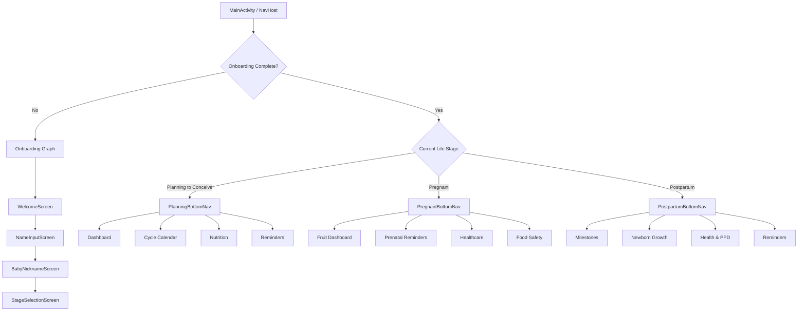

# Cocobean App Layout & Architecture Blueprint

> **Scope note:** This is a screen-level UX blueprint. It is subordinate to
> [product-brief.md](product-brief.md), [domain-model.md](domain-model.md),
> [clinical-rules.md](clinical-rules.md), and [architecture.md](architecture.md).
> Where this document conflicts with those, they win. See [README.md](README.md) for the
> full document map.
>
> **MVP scope:** Onboarding, pregnancy journey, kick counter, appointments, and hospital
> bag checklist. Screens marked `[MVP]` ship in the MVP; everything else is post-MVP. See
> [mvp.md](mvp.md).

This document outlines the UI component hierarchy, screen layouts, navigation structure, and design system for the **Cocobean** app, strictly adhering to the user flows defined in [userflow.md](userflow.md).

---

## 1. High-Level Navigation & App Structure

Cocobean uses a **Single-Activity Architecture** with **Jetpack Compose Navigation** (`androidx.navigation3` or Compose Navigation). The app dynamically adapts its main tab structure based on the user's selected life stage:
1. **Onboarding Graph**: Initial local profile setup and stage selection (no account or sign-in).
2. **Main App Shell (`AppScaffold`)**:
   - **Planning to Conceive Mode**: Dashboard, Cycle/Ovulation Calendar, Nutrition Guide, Reminders.
   - **Pregnant Mode**: Gestational Dashboard (Fruit Visuals), Prenatal Reminders (Hydration/Walking), Healthcare Appointments, Food Safety / Condition Tracker.
   - **Postpartum Mode**: Postpartum Milestones, Newborn Growth Tracker, Health & Wellness Board (Vaccines, PPD Check).

---

## 2. Onboarding Screens

### 2.1. Welcome & Account Setup (`WelcomeScreen.kt`, `NameInputScreen.kt`) [MVP]
- **Layout (`Column` with `Material3` Cards & TextFields)**:
  - App Logo & Warm Greeting ("Welcome to Cocobean").
  - `OutlinedTextField` for User Name.
  - Optional `OutlinedTextField` for Baby Nickname (e.g., "Little Bean", "Peanut").
  - Primary Action Button: `Button("Continue")`.

### 2.2. Stage Selection Screen (`StageSelectionScreen.kt`) [MVP]
- **Layout (`LazyColumn` or vertical stack of selectable cards)**:
  - Header: *"Where are you on your journey?"*
  - Card 1: **Planning to Conceive** (Icon: Seedling, Description: Track ovulation, cycle, and conception nutrition).
  - Card 2: **Pregnant** (Icon: Baby bump / Fruit, Description: Due date countdown, fruit growth, prenatal care).
  - Card 3: **Postpartum** (Icon: Newborn / Heart, Description: Postpartum recovery, newborn milestones, health).
  - **MVP:** only **Pregnant** is selectable; Planning to Conceive and Postpartum render as
    disabled cards labelled *"Coming soon"*.

---

## 3. Stage-Specific UI Layouts & Component Hierarchies

### 3.1. 👨‍🍼 Planning to Conceive Layout [Post-MVP]
- **Bottom Nav Tabs**: `[ Dashboard ] [ Cycle / Ovulation ] [ Nutrition ] [ Reminders ]`
- **Dashboard Screen**:
  - Current cycle day indicator.
  - Fertile window countdown card.
  - Quick-log button for period start / ovulation test results.
- **Cycle & Ovulation Calendar Screen**:
  - Interactive calendar highlighting menstrual days, the fertile window **range**, and an estimated ovulation **range** — never a single guaranteed day. See [clinical-rules.md](clinical-rules.md) §4.
- **Nutrition Guide Screen**:
  - Conception-worthy foods list (avocados, blueberries, leafy greens, healthy fats).
  - Quick tips for the two-week wait.
- **Reminders Screen**:
  - Two-week wait reminder configuration (supplements like folic acid, testing reminders).

---

### 3.2. 🤱 Pregnant Layout [MVP]
- **Bottom Nav Tabs (MVP)**: `[ Growth Dashboard ] [ Kick Counter ] [ Appointments ] [ Hospital Bag ]`
- **Post-MVP tabs**: Reminders, Food Safety.
- **Growth Dashboard Screen (`PregnancyDashboardScreen.kt`)** [MVP]:
  - **Hero Card**: Gestational age (e.g., *Week 24 • 3 months to go*).
  - **Fruit Visual Comparison**: Large graphic card showing baby size (e.g., *"Your baby is the size of an ear of corn / papaya"* with an illustration).
  - **Countdown Widget**: Days remaining until due date.
  - **Quick Daily Log** [Post-MVP]: Symptoms (morning sickness, energy), mood, and weight.
- **Kick Counter Screen (`KickCounterScreen.kt`)** [MVP]:
  - Start/stop a session; count movements toward 10 within 2 hours.
  - Red-flag copy if fewer than 10 in 2 hours ("contact your provider today").
- **Prenatal Reminders Screen (`PrenatalRemindersScreen.kt`)** [Post-MVP]:
  - **Hydration Tracker**: 2-hour interval reminder toggle & glass count progress bar.
  - **Activity & Walking Tracker**: 4-hour interval walking / gentle movement reminder board.
  - **Supplement Schedule**: Prenatal vitamins, iron, calcium checklists.
- **Healthcare & Appointments Screen (`HealthcareAppointmentsScreen.kt`)** [MVP]:
  - Calendar view highlighting upcoming ultrasounds, doctor visits, and lab tests.
  - "Add to calendar" button (one-way insert into the system calendar; no two-way sync).
  - Hospital bag checklist [MVP]; emergency contacts [Post-MVP].
- **Food Safety & Condition Tracker (`FoodSafetyTrackerScreen.kt`)** [Post-MVP]:
  - **Searchable Food Safety Lookup**: Search any food item instantly (Safe, Moderate, Avoid).
  - **Condition Toggles**: e.g. gestational diabetes mode, which adjusts food notes and enables a glucose log. The app records what the user's provider recommends; it does not set intake limits.
  - **Meal Logger**: Log breakfast, lunch, dinner with nutritional impact notes.

---

### 3.3. 👶 Postpartum Layout [Post-MVP]
- **Bottom Nav Tabs**: `[ Milestones ] [ Newborn Growth ] [ Health & PPD ] [ Reminders ]`
- **Postpartum Milestones Screen (`PostpartumMilestonesScreen.kt`)**:
  - Baby age counter (e.g., *6 weeks old*).
  - Interactive milestone checklist based on a reviewed source (e.g. CDC), with age **windows** rather than deadlines. "Sleeping through the night" is not a developmental milestone and must not be scored.
  - Photo attachment & memory note card for each milestone.
- **Newborn Growth & Tracking Screen (`NewbornGrowthScreen.kt`)**:
  - Feeding, diaper, and sleep logs.
  - Growth trend log (weight, length, head circumference). Percentile curves are a V1.1 addition; see [roadmap.md](roadmap.md).
- **Health & Wellness & PPD Screen (`PostpartumHealthScreen.kt`)**:
  - **Mom's Recovery Tracker**: Postpartum checkup scheduler, pelvic floor recovery exercises.
  - **Vaccination & Screening Board**: Infant immunization schedule and pediatric appointments.
  - **Postpartum Depression (PPD) Check-In**: Gentle, private mental health check-in using a validated instrument (EPDS), with immediate crisis resources if self-harm is indicated. Not a slider, and not a diagnosis. See [clinical-rules.md](clinical-rules.md) §13.

---

## 4. Design System & Theme Guidelines (`Theme.kt`, `Color.kt`)

### 4.1. Color Palette (Calming & Compassionate M3)
- **Primary**: Soft Sage Green (`#4E7959` / `#88B092`) representing growth, calm, and health.
- **Secondary**: Warm Peach / Terracotta (`#D98880` / `#E5A49D`) for warmth and maternal care.
- **Background / Surface**: Warm Cream / Off-White (`#F9F8F6`) to prevent eye strain during night feeds.
- **Warning / Alert (Food Safety)**: Soft Amber (`#F39C12` for Moderate) and Muted Coral (`#C0392B` for Avoid — used sparingly). Text-bearing badges use the darker accessible variants in [design-system.md](design-system.md) §2.4.
- **Text**: Deep Charcoal (`#2C3E50`) for maximum readability.

### 4.2. Accessibility Standards
- **Minimum Touch Target**: 48dp x 48dp on all interactive elements.
- **Typography Scale**: Large, clear font hierarchy supporting system font scaling.
- **TalkBack Support**: Explicit content descriptions on all fruit illustrations, icons, and interactive cards.
- **Edge-to-Edge**: Full edge-to-edge layout with proper WindowInsets handling for system bars.
