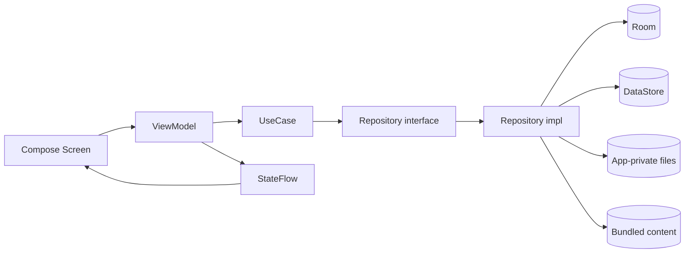

# Architecture

> Status: 🟡 Proposed. Optimized for a small team and a long-lived offline app, not for
> resume-driven complexity.
>
> **MVP scope:** the MVP builds only onboarding, the pregnancy journey, kick counter,
> appointments, and the hospital bag checklist. The architecture below is unchanged; the
> module strategy (§2) is the MVP shape. See [mvp.md](mvp.md).

## 1. Principles

1. **Offline is the architecture, not a cache layer.** No network code, no sync engine,
   no remote feature flags.
2. **Domain is pure Kotlin.** Date math, risk rules, and state transitions are testable
   without Android.
3. **One source of truth per fact.** Derived values are computed, not duplicated.
4. **Fail visibly, recover gracefully.** Missing data shows a setup prompt, not a crash.
5. **Boring technology.** Stable libraries, no alpha navigation frameworks in the MVP.

## 2. Module strategy [MVP]

**MVP: single Gradle module (`:app`) with enforced package boundaries.**

Why: a solo/small team pays a high cost for multi-module builds, and the app is small
enough that package boundaries plus code review are sufficient. Extract modules when
build times exceed ~60s or when a second app needs shared code.

```
com.cocobean.app
├── app/                     # MainActivity, CocobeanApp, NavHost, DI entry points
├── core/
│   ├── common/              # Result, AppError, Clock, Dispatchers, Ids, Units
│   ├── designsystem/        # Theme, tokens, reusable components
│   ├── database/            # Room DB, DAOs, entities, migrations, converters
│   ├── datastore/           # Preferences DataStore
│   ├── content/             # Bundled content loading, versioning, search
│   ├── notifications/       # Scheduler abstraction, channels, receivers
│   ├── security/            # App lock, biometric, export encryption
│   └── testing/             # Fakes, fixtures, test rules
├── domain/
│   ├── model/               # Pure Kotlin models (Journey, Pregnancy, FoodItem…)
│   ├── repository/          # Interfaces
│   └── usecase/             # One action per class, pure where possible
├── data/
│   ├── repository/          # Implementations
│   ├── mapper/              # Entity ↔ domain
│   └── source/              # Room, DataStore, files, content assets
└── feature/
    ├── onboarding/
    ├── home/
    ├── planning/
    ├── pregnancy/
    ├── postpartum/
    ├── foodsafety/
    ├── reminders/
    ├── appointments/
    ├── settings/
    └── export/
```

**Boundary rules**

- `feature/*` may depend on `domain` and `core/designsystem`; never on `data`.
- `data` implements `domain/repository`; never depends on `feature`.
- `domain` depends on nothing Android except `java.time`.
- `core/*` may depend on `domain` only if it is a pure utility; prefer not.

## 3. Layers and data flow



- **UDF:** ViewModel exposes `StateFlow<UiState>`; the screen renders it and sends
  events back via lambdas.
- **One-off effects** (navigation, snackbar) use `Channel<UiEffect>` consumed with
  `LaunchedEffect`.
- **No Android types in domain.** `LocalDate`, `Instant`, `Duration` only.
- **Repositories return domain models**, not Room entities.
- **UseCases are small and named after the user action** (`LogFoodEntry`,
  `ChangeDueDate`, `StartPregnancyJourney`).

## 4. Dependency injection

- **Hilt** for Android components, ViewModels, repositories, and the scheduler.
- **Manual constructor injection** for pure domain classes and use cases.
- **Qualifiers** for `Clock`, `Dispatcher`, `ContentVersion`.
- **No service locator**, no global singletons except the `Application`.

## 5. Navigation

- **Navigation Compose with type-safe routes** (Kotlin serialization). Do not adopt
  `navigation3` until it is stable; the app does not need it.
- **Nested graphs:**
  - `onboarding` (welcome → name → stage → setup → disclaimer)
  - `main` (shell with bottom nav)
    - `planning` (dashboard, cycle, nutrition, reminders)
    - `pregnancy` (dashboard, reminders, healthcare, food safety)
    - `postpartum` (milestones, growth, health, reminders)
  - `settings`, `export`, `about`, `emergency`
- **Bottom nav is derived from the primary journey type**, not stored separately.
- **Deep links:** `cocobean://journey/{id}/...`, `cocobean://reminder/{id}`,
  `cocobean://appointment/{id}`.
- **Back behavior:** predictive back supported; no custom back handling unless needed.
- **State restoration:** `rememberSaveable` for transient UI state; ViewModel for
  screen state; Room/DataStore for durable state.

## 6. State management

```kotlin
data class PregnancyDashboardUiState(
    val isLoading: Boolean = true,
    val journey: Journey? = null,
    val gestationalAge: GestationalAge? = null,
    val fruit: FruitSize? = null,
    val daysRemaining: Int? = null,
    val todayLog: DailyLog? = null,
    val error: AppError? = null,
)
```

- `UiState` is immutable and exhaustive.
- Loading, empty, error, and content are explicit states — no nullable soup.
- `collectAsStateWithLifecycle()` in Compose.
- Events are not stored in state (no `Event<T>` wrappers); use a `Channel`.
- ViewModels survive configuration changes; they do not hold `Context`.

## 7. Error handling

```kotlin
sealed interface AppError {
    data object NotFound : AppError
    data object StorageFull : AppError
    data class Validation(val field: String, val message: String) : AppError
    data class Unexpected(val cause: Throwable?) : AppError
}
```

- Repositories return `Result<T>` or throw domain exceptions caught at the ViewModel
  boundary.
- User-facing messages are mapped in the presentation layer, not in the data layer.
- Never show a raw exception or stack trace.
- Every error state has a recovery action ("Try again", "Go back", "Export data").
- Coroutine failures are caught per-screen; a single failure must not crash the app.

## 8. Clock, locale, units

- `Clock` interface with `SystemClock` and `TestClock`.
- `LocaleProvider` for date/number formatting.
- `UnitConverter` for kg/lb, cm/in, ml/oz; store metric.
- No `System.currentTimeMillis()` or `LocalDate.now()` in domain code.
- Timezone changes are observed and trigger reminder rescheduling.

## 9. Build configuration

Current template issues to fix before feature work:

| Issue | Recommendation |
|---|---|
| `namespace = "com.example.cocobean"` | Rename to a real ID (e.g. `app.cocobean`) **now**; changing later breaks installs and exports. |
| Java 11 | Use Java 17 (AGP 9 requires it; Compose tooling prefers it). |
| No KSP | Add KSP for Room and Hilt. |
| No Hilt/Room/WorkManager/DataStore | Add via version catalog. |
| `allowBackup="true"` | Set `false`; provide explicit encrypted export. |
| Dynamic color enabled | Disable for brand consistency and contrast guarantees. |
| No `INTERNET` permission | Keep it that way; add a CI check that fails if it appears. |
| No release signing | Add a signing config (keystore not committed). |
| No R8 config | Enable minify/shrink for release; keep rules for Room/Hilt. |
| No baseline profile | Add after MVP for startup performance. |

### 9.1. Dependencies (proposed)

| Area | Library | Why |
|---|---|---|
| DI | Hilt | Standard, testable. |
| DB | Room + KSP | Relational data, migrations, FTS. |
| Prefs | DataStore | Async, no SharedPreferences. |
| Background | WorkManager | Reliable deferrable reminders. |
| Navigation | Navigation Compose | Stable, type-safe routes. |
| Time | `java.time` (desugaring not needed at minSdk 34) | |
| Serialization | kotlinx.serialization | Export/import, type-safe routes. |
| Images | Coil | Local photo loading. |
| Security | `androidx.biometric` | App lock. |
| Testing | JUnit5 or JUnit4, Turbine, Truth, Robolectric, Compose UI test | |
| Screenshot | Roborazzi or Paparazzi | Visual regression. |
| Static analysis | ktlint + detekt | Consistency. |

Avoid: Retrofit/OkHttp (no network), Firebase, analytics SDKs, ad SDKs, crash reporters
that require internet.

## 10. Performance

- Room indices on `journeyId`, `loggedOn`, `childId`, `startsAt`.
- FTS4/FTS5 virtual table for food search.
- Paging 3 for long logs (or simple `LIMIT` queries post-MVP).
- Compose: stable data classes, `key` in lists, avoid recomposition-heavy lambdas.
- Content DB loaded once at startup on `Dispatchers.IO`; search on a background thread.
- Baseline profile after MVP.
- No work on the main thread; StrictMode in debug.

## 11. Security posture

- No `INTERNET` permission in MVP.
- App-private storage only; no external storage writes.
- Optional SQLCipher for the user DB (decide in `open-questions.md` Q-08).
- Optional biometric app lock with PIN fallback.
- Optional `FLAG_SECURE` for screenshots.
- Export files encrypted by default; share via SAF.
- No logs containing health data in release builds.
- ProGuard/R8 removes debug logging.

## 12. Testing seams

- `Clock`, `IdGenerator`, `NotificationScheduler`, `ContentRepository` are interfaces.
- Repositories are interfaces; fakes live in `core/testing`.
- ViewModels are tested with `Turbine` and a `TestDispatcher`.
- Date math is tested with fixed clocks and property-based tests.

## 13. What we deliberately do not build

- A sync engine.
- A remote config system.
- A plugin system.
- A custom design system from scratch (use Material 3 + tokens).
- A multi-module build in the MVP.
- A web or iOS client.
