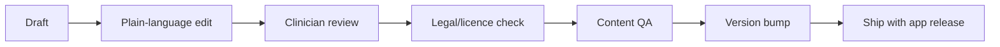

# Content Strategy

> Status: 🟡 Proposed. Content is the product. A beautiful app with unreviewed medical
> text is a liability.

## 1. Content types

Rows marked `[MVP]` ship in the MVP; everything else is post-MVP. See [mvp.md](mvp.md).

| Type | Examples | Volume (MVP) | Update cadence |
|---|---|---|---|
| Food safety | Salmon, brie, deli turkey, herbal tea | 300–500 items (V1.1) | Quarterly review |
| Fruit/vegetable size [MVP] | Poppy seed → watermelon | 40 weeks | Annual |
| Week-by-week pregnancy [MVP] | What's developing, what you may feel | 40 weeks | Annual |
| Birth plan topics [MVP] | Pain relief, support people, newborn care | ~15 topics | Annual |
| Milestones | First smile, first steps | ~60 items | Annual |
| Vaccines | DTaP, MMR, flu | Region-specific | Annual |
| Red flags | Preeclampsia signs, reduced movement | ~20 | Annual |
| Nutrition/supplements | Folic acid, caffeine, iron | ~30 | Annual |
| Mental health | EPDS, coping, crisis | ~15 | Annual |
| Postpartum recovery | C-section, pelvic floor, feeding | ~40 | Annual |
| Copy deck | Buttons, empty states, errors | ~300 strings | Continuous |

## 2. Sourcing and licensing

### 2.1. Allowed sources

- **US government works** (CDC, FDA, NIH, EPA): generally public domain, but verify each
  page; some contain third-party images.
- **ACOG patient materials**: copyrighted; summarize, do not copy; cite.
- **NHS**: Crown copyright; much is under the Open Government Licence, but not all.
  Verify per page and attribute.
- **WHO**: check the specific publication's licence (often CC BY-NC-SA).
- **Peer-reviewed literature**: cite; do not reproduce tables without permission.

### 2.2. Rules

1. Write **original** plain-language summaries. Never paste source text.
2. Every content row stores `sourceRefs` (stable citation IDs) and `reviewedOn`.
3. Images and illustrations must be commissioned or licensed. No scraping.
4. Fonts must be licensed for app embedding.
5. Keep a `docs/content/ATTRIBUTIONS.md` with source, licence, and URL.
6. If a licence is unclear, do not ship the content.

### 2.3. What we will not do

- Copy a competitor's food database.
- Use AI-generated medical text without clinician review.
- Present a single study as consensus.
- Ship region-specific guidance to the wrong region.

## 3. Content schemas

### 3.1. Food item

```json
{
  "id": "food.cheese.brie",
  "name": "Brie",
  "aliases": ["brie cheese"],
  "category": "dairy",
  "risk": "AVOID",
  "rationale": "Soft mould-ripened cheeses are more likely to contain Listeria unless they are made from pasteurised milk and clearly labelled.",
  "conditions": { "GESTATIONAL_DIABETES": "MODERATE" },
  "caffeineMgPerServing": null,
  "mercuryLevel": "UNKNOWN",
  "allergens": ["milk"],
  "tags": ["unpasteurized", "listeria", "soft-cheese"],
  "sourceRefs": ["cdc.listeria", "nhs.cheese"],
  "reviewedOn": "2026-10-01",
  "contentVersion": "1.0.0"
}
```

### 3.2. Fruit size

```json
{
  "week": 8,
  "name": "Raspberry",
  "lengthCm": 1.6,
  "weightG": 1,
  "illustration": "fruit/raspberry.webp",
  "altText": "A raspberry, about 1.6 centimetres long",
  "note": "Tiny but growing fast.",
  "sourceRefs": ["acog.week8"]
}
```

Sizes are approximate and vary by source. Pick one source, state it, and do not imply
medical precision.

### 3.3. Milestone

```json
{
  "key": "social.first_smile",
  "title": "First social smile",
  "description": "Smiles in response to you, not just randomly.",
  "category": "SOCIAL",
  "windowStartMonths": 1,
  "windowEndMonths": 3,
  "redFlags": ["No smile by 3 months"],
  "sourceRef": "cdc.milestones.2m",
  "reviewedOn": "2026-10-01"
}
```

### 3.4. Vaccine

```json
{
  "key": "us.dtap.1",
  "name": "DTaP",
  "doseNumber": 1,
  "recommendedAgeMonths": 2,
  "region": "US",
  "notes": "Part of the routine childhood schedule.",
  "sourceRef": "cdc.immunization.schedule",
  "reviewedOn": "2026-10-01"
}
```

## 4. Authoring workflow



1. **Draft** from a cited source.
2. **Plain-language edit**: grade 6–8 reading level, short sentences, no jargon.
3. **Clinician review**: named reviewer, date, comments resolved.
4. **Licence check**: source and images cleared.
5. **Content QA**: schema validation, no missing fields, no `UNKNOWN` rendered as safe.
6. **Version bump**: semantic version; migration notes.
7. **Ship**: bundled in the APK; no network fetch.

## 5. Review cadence

- **Quarterly**: food safety, red flags, crisis numbers.
- **Annually**: milestones, vaccines, week-by-week, fruit sizes.
- **On guideline change**: immediate review; ship a patch release.
- **On user report**: triage within 7 days; correct or explain.

Every content row has `reviewedOn`; the app shows "Content reviewed: <date>" in About.

## 6. Localization

- All user-facing strings in `strings.xml`; no hardcoded text in Composables.
- Use ICU message format for plurals and gender-neutral phrasing.
- Dates and numbers via `DateTimeFormatter`/`NumberFormat` with the user's locale.
- Units: metric/imperial toggle; store metric.
- Food names: localize common names; keep aliases for search.
- RTL: test Arabic/Hebrew layouts even if not shipping those locales yet.
- Region-specific content: vaccines, crisis numbers, food guidance, emergency numbers.
- Do not machine-translate medical content without review.

## 7. Versioning

- `contentVersion` (semver) stored in the DB and shown in About.
- Content tables are replaced atomically on app upgrade.
- User data references content by stable ID; if an ID is removed, keep the user's
  snapshot and show "this item is no longer in our guide."
- Never renumber IDs.

## 8. Content QA checklist

- [ ] Every row has `sourceRefs` and `reviewedOn`.
- [ ] No `UNKNOWN` risk is displayed as safe.
- [ ] No diagnostic language ("you have", "this means").
- [ ] No shaming language ("bad", "should have", "cheating").
- [ ] Reading level ≤ grade 8.
- [ ] Allergens and condition modifiers present where relevant.
- [ ] Images have alt text and licences.
- [ ] Region-specific rows are tagged and filtered.
- [ ] Crisis numbers verified for each supported region.
- [ ] Clinician sign-off recorded.

## 9. Attribution

Ship an "About → Sources & licences" screen listing:

- content sources and review dates,
- illustration and font licences,
- open-source libraries and their licences,
- a plain-language privacy policy.

## 10. Open content decisions

- Which region(s) at launch? (See `open-questions.md` Q-02.)
- Do we commission original illustrations or license a set?
- Do we have a clinician reviewer, and what is the review budget?
- Do we ship a food DB of 300 items or 1,000? (Recommend 300 well-reviewed over 1,000
  unreviewed.)
