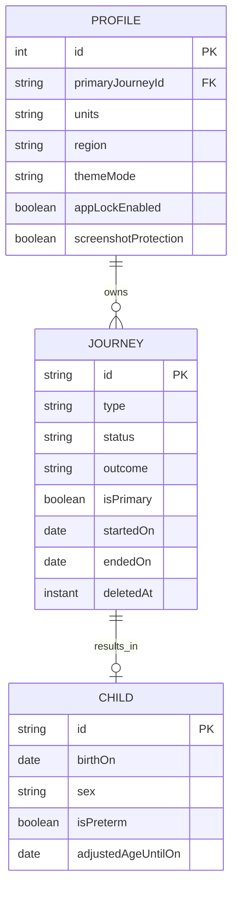
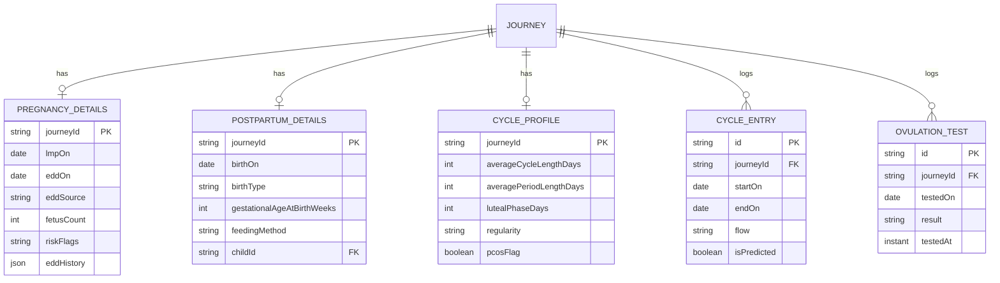
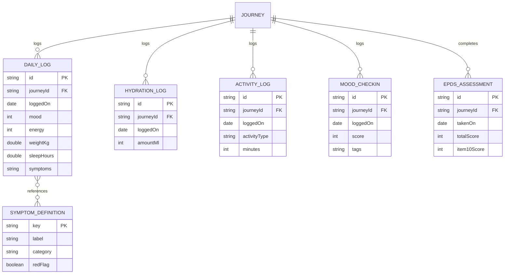
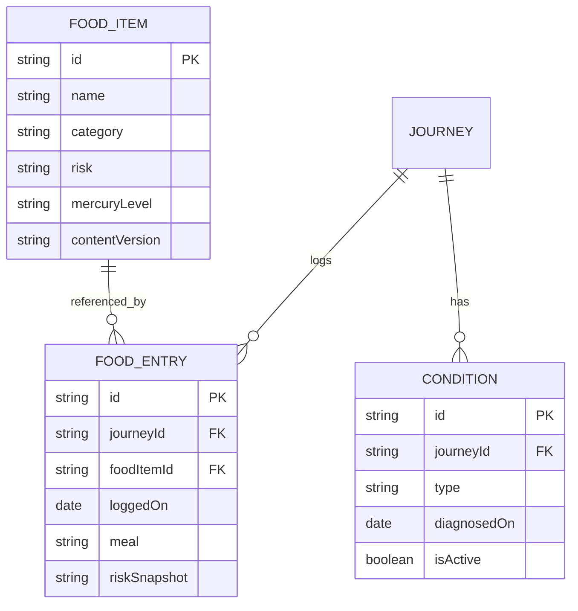
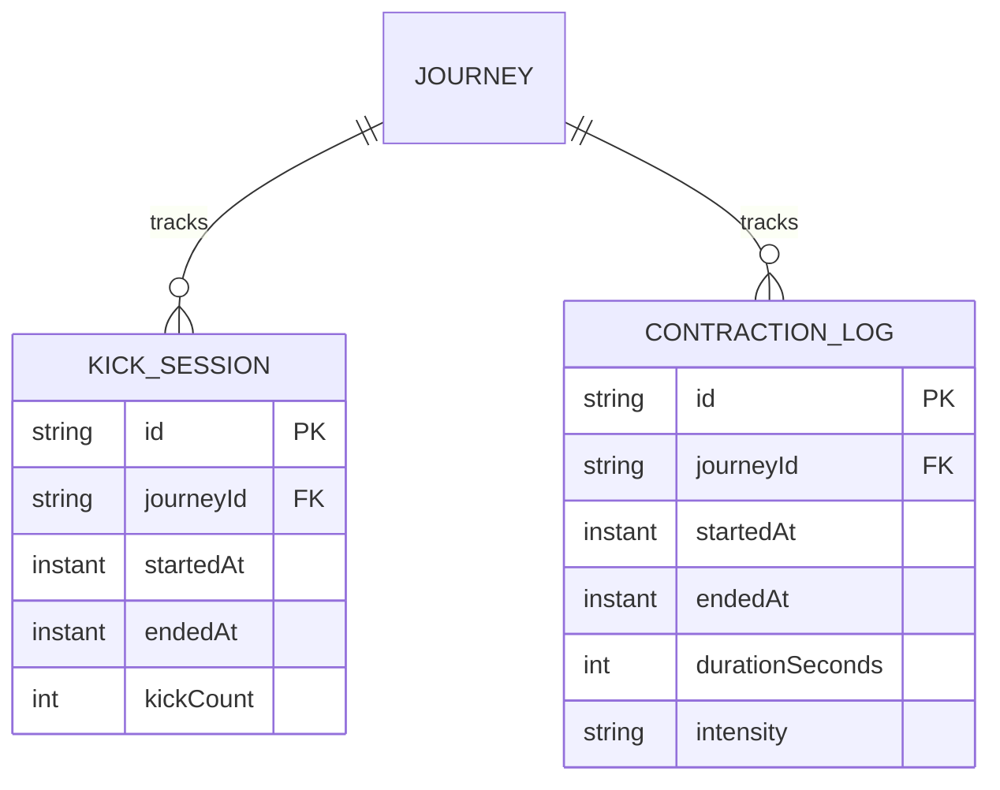
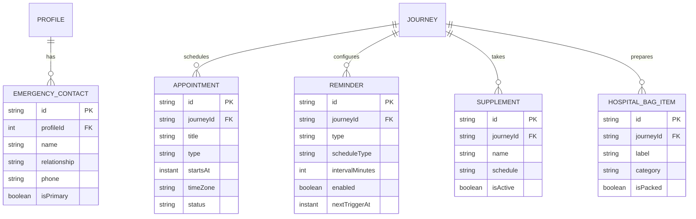
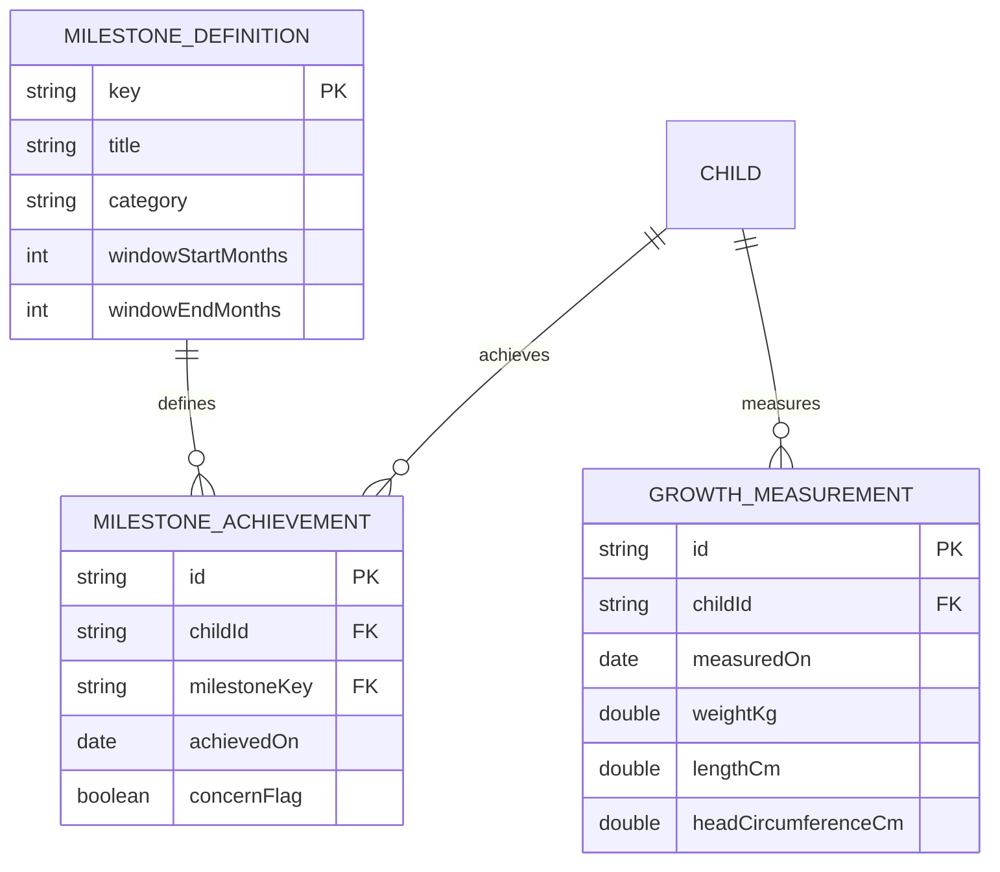
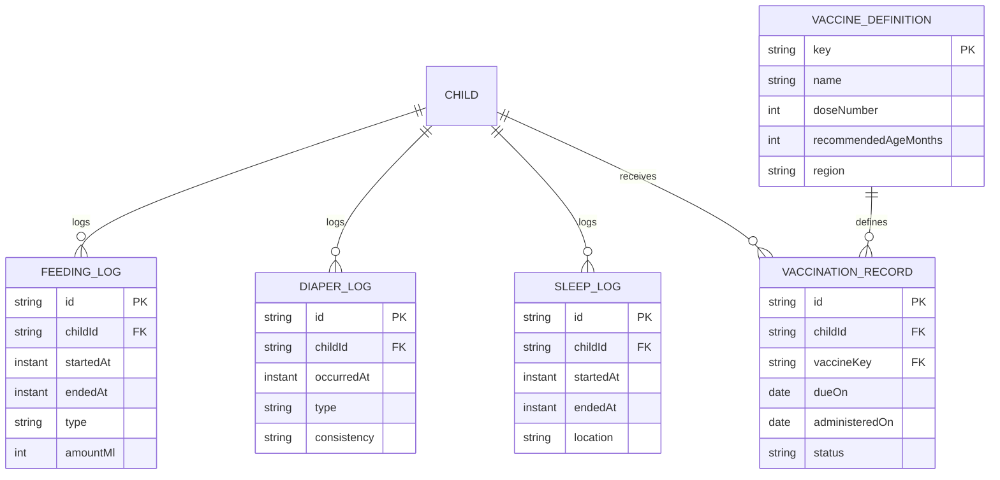
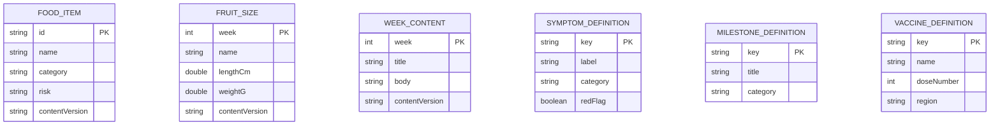
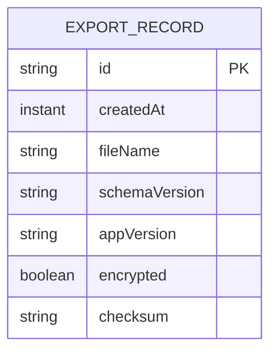

# Domain Model — Entity Relationship Diagrams

> Companion to [domain-model.md](domain-model.md). The authoritative field definitions,
> rules, and invariants live there; this file is a visual index. Field lists here are
> abbreviated (keys + the most important columns).

## Why several small diagrams instead of one big one?

Zed's markdown preview renders each mermaid block as a **static SVG** — there is no
pan/zoom or horizontal scroll, so a wide diagram overflows and is hard to read. Each
diagram below is deliberately small (≤ ~6 entities). For the full graph, see
[domain-model.md §2](domain-model.md#2-entity-relationship-overview).

**Viewing tips**

1. Use the split diagrams below — they are sized to fit.
2. For the full graph, copy a block into <https://mermaid.live> (pan, zoom, export SVG/PNG).
3. Widen the editor pane, or open the preview in its own window/tab.
4. Optional: export to an image with the Mermaid CLI
   (`npx @mermaid-js/mermaid-cli -i diagram.mmd -o diagram.svg`; requires Node).

**Legend**

| Notation | Meaning |
|---|---|
| `||--o|` | one to zero-or-one |
| `||--o{` | one to many |
| `}o--o{` | many to many |
| `PK` / `FK` | primary key / foreign key |
| **content** | bundled, read-only, versioned reference data |

---

## 1. Identity & journeys

## 2. Stage details

## 3. Daily logging

## 4. Food & conditions

## 5. Kick counter & contractions

## 6. Care & reminders

## 7. Postpartum — milestones & growth

## 8. Postpartum — baby logs & vaccines

## 9. Content tables (cross-cutting)

## 10. Export

---

## Relationship matrix

A compact, text-only view of the same relationships (useful when a diagram is too wide).

| Entity | Kind | Parent / FK | Related entities |
|---|---|---|---|
| Profile | user | — | Journey, EmergencyContact |
| Journey | user | Profile.primaryJourneyId | PregnancyDetails, PostpartumDetails, CycleProfile, CycleEntry, OvulationTest, DailyLog, FoodEntry, Condition, Appointment, Reminder, Supplement, HydrationLog, ActivityLog, MoodCheckIn, EpdsAssessment, HospitalBagItem, KickSession, ContractionLog, Child |
| PregnancyDetails | user | Journey (1:1) | — |
| PostpartumDetails | user | Journey (1:1), Child | — |
| Child | user | Journey (1:1) | MilestoneAchievement, GrowthMeasurement, FeedingLog, DiaperLog, SleepLog, VaccinationRecord |
| CycleProfile | user | Journey (1:1) | — |
| CycleEntry | user | Journey | — |
| OvulationTest | user | Journey | — |
| DailyLog | user | Journey | SymptomDefinition (M:N) |
| FoodItem | content | — | FoodEntry |
| FoodEntry | user | Journey, FoodItem | — |
| Condition | user | Journey | — |
| Appointment | user | Journey | — |
| Reminder | user | Journey (nullable) | — |
| Supplement | user | Journey | — |
| HydrationLog | user | Journey | — |
| ActivityLog | user | Journey | — |
| MilestoneDefinition | content | — | MilestoneAchievement |
| MilestoneAchievement | user | Child, MilestoneDefinition | — |
| GrowthMeasurement | user | Child | — |
| FeedingLog | user | Child | — |
| DiaperLog | user | Child | — |
| SleepLog | user | Child | — |
| VaccineDefinition | content | — | VaccinationRecord |
| VaccinationRecord | user | Child, VaccineDefinition | — |
| MoodCheckIn | user | Journey | — |
| EpdsAssessment | user | Journey | — |
| EmergencyContact | user | Profile | — |
| HospitalBagItem | user | Journey | — |
| ExportRecord | user | — | — |
| FruitSize | content | — | — |
| WeekContent | content | — | — |
| SymptomDefinition | content | — | DailyLog (M:N) |
| KickSession | user | Journey | — |
| ContractionLog | user | Journey | — |

## Key invariants (see [domain-model.md §5](domain-model.md#5-invariants))

- Exactly one `Profile` row.
- Exactly one `Journey.isPrimary = true` (or zero during onboarding).
- A `PREGNANCY` journey has at most one `PregnancyDetails`.
- A `POSTPARTUM` journey has exactly one `Child`.
- `eddOn` changes are append-only in `eddHistory`.
- `FoodEntry.riskSnapshot` is immutable after insert.
- Predicted cycle entries are never treated as facts.
- Deleting a `Child` requires deleting or reassigning its logs in one transaction.
- No user data is written outside the app's private storage.
- Every content row has a `sourceRef` and `reviewedOn`.
