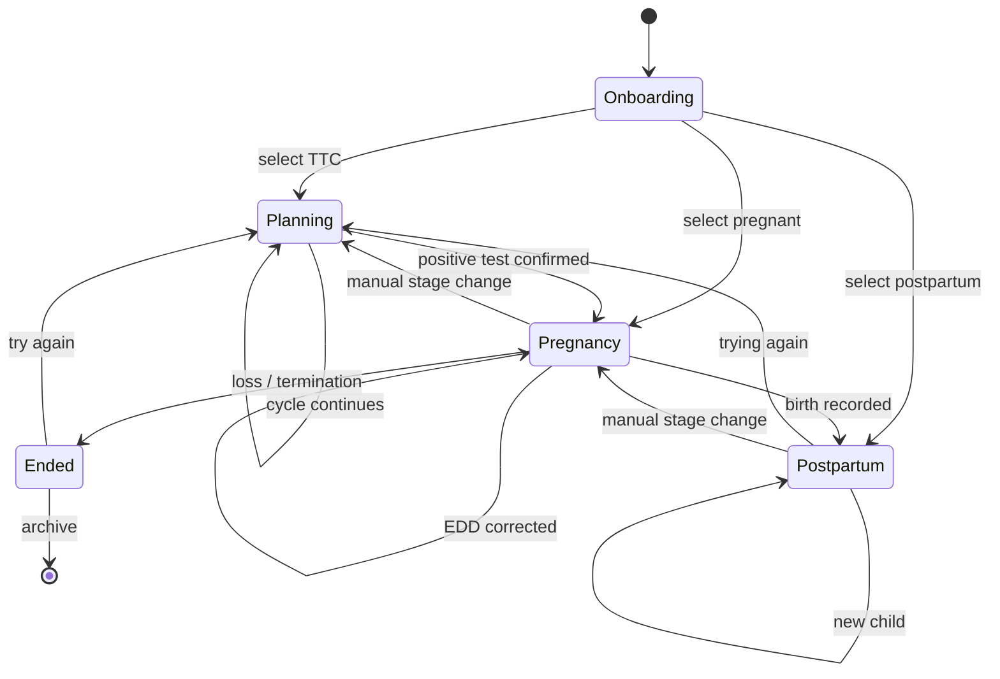

# Domain Model

> Status: 🟡 Proposed. This is the contract the database, ViewModels, and tests are built
> against. Change it before code, not after.

## 1. The central idea: a Journey

The current docs assume the user is in exactly one stage. Real users are not:

- A parent with a 6-month-old who is pregnant again has **two active journeys**.
- A user who lost a pregnancy still has a pregnancy record that must not be deleted.
- A user who is planning again after a loss has a **new** planning journey, not a reset.

So the model is:

> A **Profile** owns zero or more **Journeys**. A Journey is one tracked life-stage
> instance. Exactly one journey is **primary** at a time; the primary journey drives the
> app shell and bottom navigation.

This single decision prevents the most expensive rewrite in the app.

## 2. Entity relationship overview

```mermaid
erDiagram
    PROFILE ||--o{ JOURNEY : owns
    PROFILE ||--o{ EMERGENCY_CONTACT : has
    JOURNEY ||--o| PREGNANCY_DETAILS : has
    JOURNEY ||--o| POSTPARTUM_DETAILS : has
    JOURNEY ||--o| CYCLE_PROFILE : has
    JOURNEY ||--o{ CYCLE_ENTRY : logs
    JOURNEY ||--o{ OVULATION_TEST : logs
    JOURNEY ||--o{ DAILY_LOG : logs
    DAILY_LOG |o--o| MOOD_CHECKIN : "mood for the day"
    JOURNEY ||--o{ FOOD_ENTRY : logs
    JOURNEY ||--o{ CONDITION : has
    JOURNEY ||--o{ APPOINTMENT : schedules
    JOURNEY ||--o{ REMINDER : configures
    JOURNEY ||--o{ SUPPLEMENT : takes
    JOURNEY ||--o{ HYDRATION_LOG : logs
    JOURNEY ||--o{ ACTIVITY_LOG : logs
    JOURNEY ||--o{ MOOD_CHECKIN : logs
    JOURNEY ||--o{ EPDS_ASSESSMENT : completes
    JOURNEY ||--o{ HOSPITAL_BAG_ITEM : prepares
    JOURNEY ||--o| CHILD : results_in
    CHILD ||--o{ MILESTONE_ACHIEVEMENT : achieves
    CHILD ||--o{ GROWTH_MEASUREMENT : measures
    CHILD ||--o{ FEEDING_LOG : logs
    CHILD ||--o{ DIAPER_LOG : logs
    CHILD ||--o{ SLEEP_LOG : logs
    CHILD ||--o{ VACCINATION_RECORD : receives
    FOOD_ITEM ||--o{ FOOD_ENTRY : referenced_by
    MILESTONE_DEFINITION ||--o{ MILESTONE_ACHIEVEMENT : defines
    VACCINE_DEFINITION ||--o{ VACCINATION_RECORD : defines
    JOURNEY ||--o{ KICK_SESSION : tracks
    JOURNEY ||--o{ CONTRACTION_LOG : tracks
    DAILY_LOG }o--o{ SYMPTOM_DEFINITION : references
```

`FOOD_ITEM`, `MILESTONE_DEFINITION`, `VACCINE_DEFINITION`, `FRUIT_SIZE`, `WEEK_CONTENT`,
and `SYMPTOM_DEFINITION` are **content** tables (bundled, read-only, versioned).
Everything else is **user data**.

For smaller, per-domain diagrams (easier to read in the preview), see
[domain-model-entity-relation.md](domain-model-entity-relation.md).

**MVP entities:** `Profile`, `Journey`, `PregnancyDetails`, `Appointment`,
`HospitalBagItem`, `FruitSize`, `WeekContent`, `KickSession`. Everything else is post-MVP.
See [mvp.md](mvp.md).

## 3. Entities

Entities marked `[MVP]` ship in the MVP; everything else is post-MVP. See [mvp.md](mvp.md).

### 3.1. Profile (singleton, `id = 1`) [MVP]

| Field | Type | Notes |
|---|---|---|
| `id` | Int PK | Always 1. No multi-profile in MVP. |
| `displayName` | String? | Optional. Never required. |
| `preferredName` | String? | Used in copy; falls back to "you". |
| `createdAt` | Instant | |
| `onboardingCompletedAt` | Instant? | Null = resume onboarding. |
| `primaryJourneyId` | String? | FK → Journey. |
| `units` | `METRIC` / `IMPERIAL` | Weight, length, temperature. |
| `region` | String | ISO 3166-1 alpha-2. Drives vaccine schedule, crisis numbers, food guidance. |
| `themeMode` | `SYSTEM` / `LIGHT` / `DARK` | |
| `appLockEnabled` | Boolean | |
| `appLockTimeoutSeconds` | Int | Default 60. |
| `screenshotProtection` | Boolean | `FLAG_SECURE`. |
| `disclaimerAcceptedAt` | Instant? | Required before main app. |
| `contentVersion` | String | Installed content DB version. |
| `lastExportAt` | Instant? | Nudge only, never nag. |

### 3.2. Journey [MVP]

| Field | Type | Notes |
|---|---|---|
| `id` | String (UUIDv7) | |
| `type` | `PLANNING` / `PREGNANCY` / `POSTPARTUM` | |
| `status` | `ACTIVE` / `PAUSED` / `COMPLETED` / `ENDED` | |
| `outcome` | `ONGOING` / `BIRTH` / `LOSS` / `TERMINATION` / `ADOPTION` / `SURROGACY` / `UNKNOWN` | |
| `title` | String | e.g. "Baby Bean", "Trying again". User-editable. |
| `startedOn` | LocalDate | |
| `endedOn` | LocalDate? | |
| `isPrimary` | Boolean | Exactly one true. |
| `createdAt` / `updatedAt` | Instant | |
| `deletedAt` | Instant? | Soft delete for recovery. |

**Rules**

- A `PREGNANCY` journey MUST have `PregnancyDetails` with either `lmpOn` or `eddOn`.
  If neither, the journey is `ACTIVE` but the dashboard shows a setup prompt, not fake data.
- A `POSTPARTUM` journey MUST have `PostpartumDetails.birthOn` and a `Child`.
- A `PLANNING` journey MUST have a `CycleProfile` (defaults allowed).
- `isPrimary` is unique per profile. Switching primary is an explicit user action.
- Ending a journey never deletes it. Deletion is a separate, confirmed action.

### 3.3. PregnancyDetails (1:1 with a `PREGNANCY` journey) [MVP]

| Field | Type | Notes |
|---|---|---|
| `journeyId` | String PK/FK | |
| `lmpOn` | LocalDate? | First day of last period. |
| `eddOn` | LocalDate? | Current best estimate. |
| `eddSource` | `LMP` / `ULTRASOUND` / `MANUAL` / `IVF` / `UNKNOWN` | |
| `ultrasoundOn` | LocalDate? | Date of the scan that produced the EDD. |
| `ivfTransferOn` | LocalDate? | |
| `ivfEmbryoDay` | Int? | 3 or 5 (or 6). |
| `fetusCount` | Int | Default 1. Twins = 1 pregnancy, 2 fetuses. |
| `babyNickname` | String? | |
| `prePregnancyWeightKg` | Double? | For optional weight-gain guidance. |
| `heightCm` | Double? | |
| `riskFlags` | Set<RiskFlag> | e.g. `GESTATIONAL_DIABETES`, `HYPERTENSION`, `PREECLAMPSIA_HISTORY`. |
| `eddHistory` | List<EddChange> | Audit trail: old, new, source, changedAt. |

**Rules**

- `eddOn` is derived from `lmpOn` when `eddSource = LMP`, but stored so it can be
  overridden by a scan without losing the LMP.
- Changing `eddOn` MUST append to `eddHistory` and MUST NOT rewrite past logs.
- Gestational age is always computed from the **current** `eddOn`, never stored.
- `fetusCount > 1` changes content (twin-specific notes) but not the date math.

### 3.4. PostpartumDetails (1:1 with a `POSTPARTUM` journey)

| Field | Type | Notes |
|---|---|---|
| `journeyId` | String PK/FK | |
| `birthOn` | LocalDate | |
| `birthType` | `VAGINAL` / `CESAREAN` / `ASSISTED` / `OTHER` / `PREFER_NOT_TO_SAY` | |
| `gestationalAgeAtBirthWeeks` | Int? | For adjusted age. |
| `nicuStay` | Boolean? | |
| `feedingMethod` | `BREAST` / `FORMULA` / `MIXED` / `PUMPED` / `OTHER` | |
| `childId` | String | FK → Child. |

### 3.5. Child

| Field | Type | Notes |
|---|---|---|
| `id` | String | |
| `name` | String? | |
| `birthOn` | LocalDate | |
| `sex` | `FEMALE` / `MALE` / `INTERSEX` / `UNKNOWN` / `PREFER_NOT_TO_SAY` | Optional; used only for growth charts. |
| `photoPath` | String? | Relative path in app-private storage. |
| `isPreterm` | Boolean | Derived from GA at birth < 37w. |
| `adjustedAgeUntilOn` | LocalDate? | Birth + 2 years if preterm. |

### 3.6. CycleProfile (1:1 with a `PLANNING` journey)

| Field | Type | Notes |
|---|---|---|
| `journeyId` | String PK/FK | |
| `averageCycleLengthDays` | Int | Default 28. Clamp 21–45. |
| `averagePeriodLengthDays` | Int | Default 5. |
| `lutealPhaseDays` | Int | Default 14. Clamp 10–17. |
| `regularity` | `REGULAR` / `IRREGULAR` / `UNKNOWN` | Derived or user-set. |
| `lastPeriodStart` | LocalDate? | |
| `pcosFlag` | Boolean | User-set; disables confident predictions. |
| `contraception` | String? | Content only; no predictions while on hormonal contraception. |

### 3.7. CycleEntry

| Field | Type | Notes |
|---|---|---|
| `id` | String | |
| `journeyId` | String | |
| `startOn` | LocalDate | |
| `endOn` | LocalDate? | Null = ongoing. |
| `flow` | `SPOTTING` / `LIGHT` / `MEDIUM` / `HEAVY` | |
| `isPredicted` | Boolean | Predicted entries are never editable as facts. |
| `notes` | String? | |

### 3.8. OvulationTest

| Field | Type | Notes |
|---|---|---|
| `id` | String | |
| `journeyId` | String | |
| `testedOn` | LocalDate | |
| `result` | `NEGATIVE` / `POSITIVE` / `PEAK` / `INVALID` | |
| `testedAt` | Instant? | Optional time. |

### 3.9. DailyLog

| Field | Type | Notes |
|---|---|---|
| `id` | String | |
| `journeyId` | String | |
| `loggedOn` | LocalDate | One per day per journey (upsert). |
| `moodCheckInId` | String? | FK → MoodCheckIn. Null = no mood logged that day. |
| `energy` | Int? | 1–5. |
| `weightKg` | Double? | |
| `sleepHours` | Double? | |
| `symptoms` | List<SymptomTag> | Catalog-backed. |
| `notes` | String? | |

### 3.10. FoodItem (content)

| Field | Type | Notes |
|---|---|---|
| `id` | String | Stable, e.g. `food.salmon.farmed`. |
| `name` | String | |
| `aliases` | List<String> | Search. |
| `category` | String | Fish, dairy, meat, produce, drinks, herbs… |
| `risk` | `SAFE` / `MODERATE` / `AVOID` / `UNKNOWN` | |
| `rationale` | String | Plain-language why. |
| `conditions` | Map<ConditionType, Risk> | e.g. GDM changes a food's note. |
| `caffeineMgPerServing` | Double? | |
| `mercuryLevel` | `LOW` / `MEDIUM` / `HIGH` / `UNKNOWN` | |
| `allergens` | List<String> | |
| `tags` | List<String> | `listeria`, `raw`, `unpasteurized`, `high-mercury`… |
| `sourceRefs` | List<String> | Citation IDs. |
| `reviewedOn` | LocalDate | |
| `contentVersion` | String | |

**Rule:** `UNKNOWN` is never displayed as safe. It renders as "We don't have guidance
for this yet — ask your provider."

### 3.11. FoodEntry

| Field | Type | Notes |
|---|---|---|
| `id` | String | |
| `journeyId` | String | |
| `loggedOn` | LocalDate | |
| `meal` | `BREAKFAST` / `LUNCH` / `DINNER` / `SNACK` | |
| `foodItemId` | String? | Null for custom food. |
| `customName` | String? | |
| `portion` | String? | Free text; no false precision. |
| `riskSnapshot` | Risk | Captured at log time; content updates do not rewrite history. |
| `notes` | String? | |

### 3.12. Condition

| Field | Type | Notes |
|---|---|---|
| `id` | String | |
| `journeyId` | String | |
| `type` | `GESTATIONAL_DIABETES` / `HYPERTENSION` / `ANEMIA` / `PREECLAMPSIA_HISTORY` / `THYROID` / `OTHER` | |
| `diagnosedOn` | LocalDate? | |
| `isActive` | Boolean | |
| `notes` | String? | |

### 3.13. Appointment [MVP]

| Field | Type | Notes |
|---|---|---|
| `id` | String | |
| `journeyId` | String | |
| `title` | String | |
| `type` | `PRENATAL` / `ULTRASOUND` / `LAB` / `PEDIATRIC` / `VACCINE` / `THERAPY` / `OTHER` | |
| `startsAt` | Instant | |
| `endsAt` | Instant? | |
| `timeZone` | String | IANA zone at creation. |
| `location` | String? | |
| `provider` | String? | |
| `notes` | String? | |
| `calendarEventId` | Long? | System Calendar provider ID, if inserted. |
| `reminderOffsets` | List<Duration> | e.g. 1 day, 2 hours. |
| `status` | `SCHEDULED` / `COMPLETED` / `CANCELLED` / `MISSED` | |

### 3.14. Reminder

| Field | Type | Notes |
|---|---|---|
| `id` | String | |
| `journeyId` | String? | Null = profile-level. |
| `type` | `HYDRATION` / `ACTIVITY` / `SUPPLEMENT` / `APPOINTMENT` / `FERTILE_WINDOW` / `TEST` / `MILESTONE` / `VACCINE` / `WELLBEING` / `CUSTOM` | |
| `title` | String | |
| `body` | String? | |
| `scheduleType` | `INTERVAL` / `DAILY` / `WEEKLY` / `ONE_OFF` | |
| `intervalMinutes` | Int? | |
| `timeOfDay` | LocalTime? | |
| `daysOfWeek` | Set<DayOfWeek>? | |
| `startsOn` | LocalDate | |
| `endsOn` | LocalDate? | |
| `quietHours` | `QuietHours` | Default 22:00–07:00. |
| `enabled` | Boolean | |
| `nextTriggerAt` | Instant? | Cached; recomputed by scheduler. |
| `lastTriggeredAt` | Instant? | |
| `snoozeUntil` | Instant? | |
| `linkedEntityType` / `linkedEntityId` | String? | Deep link target. |
| `channelId` | String | Notification channel. |

### 3.15. Supplement

| Field | Type | Notes |
|---|---|---|
| `id` | String | |
| `journeyId` | String | |
| `name` | String | |
| `dose` | String? | Free text; app does not recommend doses. |
| `schedule` | `DAILY` / `TWICE_DAILY` / `WEEKLY` / `CUSTOM` | |
| `timeOfDay` | LocalTime? | |
| `startsOn` / `endsOn` | LocalDate | |
| `isActive` | Boolean | |

### 3.16. HydrationLog / ActivityLog

| Field | Type | Notes |
|---|---|---|
| `id` | String | |
| `journeyId` | String | |
| `loggedOn` | LocalDate | |
| `amountMl` | Int? | Hydration. |
| `activityType` | String? | Activity. |
| `minutes` | Int? | Activity. |
| `notes` | String? | |

### 3.17. MilestoneDefinition (content) / MilestoneAchievement

Definition:

| Field | Type | Notes |
|---|---|---|
| `key` | String | e.g. `social.first_smile`. |
| `title` | String | |
| `description` | String | |
| `category` | `SOCIAL` / `LANGUAGE` / `COGNITIVE` / `MOVEMENT` / `SELF_CARE` | |
| `windowStartMonths` / `windowEndMonths` | Int | |
| `redFlags` | List<String> | "Talk to your pediatrician if…" |
| `sourceRef` | String | |
| `reviewedOn` | LocalDate | |

Achievement:

| Field | Type | Notes |
|---|---|---|
| `id` | String | |
| `childId` | String | |
| `milestoneKey` | String | |
| `achievedOn` | LocalDate? | Null = not yet. |
| `note` | String? | |
| `photoPath` | String? | |
| `concernFlag` | Boolean | User-marked concern. |

### 3.18. GrowthMeasurement

| Field | Type | Notes |
|---|---|---|
| `id` | String | |
| `childId` | String | |
| `measuredOn` | LocalDate | |
| `weightKg` | Double? | |
| `lengthCm` | Double? | |
| `headCircumferenceCm` | Double? | |
| `source` | `HOME` / `CLINIC` / `OTHER` | |

### 3.19. FeedingLog / DiaperLog / SleepLog

Feeding:

| Field | Type | Notes |
|---|---|---|
| `id` | String | |
| `childId` | String | |
| `startedAt` | Instant | |
| `endedAt` | Instant? | |
| `type` | `BREAST_LEFT` / `BREAST_RIGHT` / `BOTTLE_BREAST_MILK` / `BOTTLE_FORMULA` / `SOLID` | |
| `amountMl` | Int? | |
| `notes` | String? | |

Diaper: `id`, `childId`, `occurredAt`, `type` (`WET`/`DIRTY`/`MIXED`/`DRY`), `consistency`, `color`, `notes`.

Sleep: `id`, `childId`, `startedAt`, `endedAt`, `location`, `notes`.

### 3.20. VaccineDefinition (content) / VaccinationRecord

Definition: `key`, `name`, `doseNumber`, `recommendedAgeMonths`, `region`, `notes`, `sourceRef`, `reviewedOn`.

Record: `id`, `childId`, `vaccineKey`, `dueOn`, `administeredOn`, `status`
(`DUE`/`DONE`/`SKIPPED`/`DELAYED`), `notes`.

### 3.21. MoodCheckIn / EpdsAssessment

MoodCheckIn: `id`, `journeyId`, `loggedOn`, `score` (1–5), `tags`, `note`. This is the
**single** mood record per journey per day; `DailyLog.moodCheckInId` links to it.

**Rule:** mood is stored only here. `DailyLog` references the day's check-in via
`moodCheckInId` and does not duplicate the score.

EpdsAssessment:

| Field | Type | Notes |
|---|---|---|
| `id` | String | |
| `journeyId` | String | |
| `takenOn` | LocalDate | |
| `answers` | List<Int> | 10 items, each 0–3. |
| `totalScore` | Int | 0–30. |
| `item10Score` | Int | Self-harm item. |
| `actionShown` | String? | Which escalation was displayed. |

### 3.22. EmergencyContact [Post-MVP] / HospitalBagItem [MVP]

EmergencyContact: `id`, `profileId`, `name`, `relationship`, `phone`, `isPrimary`.

HospitalBagItem: `id`, `journeyId`, `label`, `category`, `isPacked`, `isCustom`.

### 3.23. ExportRecord

`id`, `createdAt`, `fileName`, `schemaVersion`, `appVersion`, `encrypted`, `checksum`,
`recordCounts` (JSON).

### 3.24. FruitSize / WeekContent (content) [MVP]

FruitSize:

| Field | Type | Notes |
|---|---|---|
| `week` | Int PK | 1–40. |
| `name` | String | e.g. "Raspberry". |
| `lengthCm` | Double? | Approximate. |
| `weightG` | Double? | Approximate. |
| `illustration` | String | Bundled asset path. |
| `altText` | String | Accessibility description. |
| `note` | String? | One line, non-clinical. |
| `sourceRefs` | List<String> | Citation IDs. |
| `reviewedOn` | LocalDate | |
| `contentVersion` | String | |

WeekContent:

| Field | Type | Notes |
|---|---|---|
| `week` | Int PK | 1–40. |
| `title` | String | |
| `body` | String | Plain-language, non-diagnostic. |
| `sourceRefs` | List<String> | |
| `reviewedOn` | LocalDate | |
| `contentVersion` | String | |

**Rule:** fruit sizes are approximate. Pick one source, state it, and never imply medical
precision.

### 3.25. SymptomDefinition (content)

| Field | Type | Notes |
|---|---|---|
| `key` | String | e.g. `symptom.nausea`. |
| `label` | String | |
| `category` | String | e.g. `digestive`, `mood`, `pain`. |
| `redFlag` | Boolean | True = surface "contact your provider" copy. |
| `sourceRefs` | List<String> | |
| `reviewedOn` | LocalDate | |
| `contentVersion` | String | |

`DailyLog.symptoms` stores these stable keys.

### 3.26. KickSession [MVP] / ContractionLog [Post-MVP]

KickSession:

| Field | Type | Notes |
|---|---|---|
| `id` | String | |
| `journeyId` | String | |
| `startedAt` | Instant | |
| `endedAt` | Instant? | |
| `kickCount` | Int | |
| `notes` | String? | |

ContractionLog:

| Field | Type | Notes |
|---|---|---|
| `id` | String | |
| `journeyId` | String | |
| `startedAt` | Instant | |
| `endedAt` | Instant? | |
| `durationSeconds` | Int? | Derived from start/end. |
| `intensity` | `MILD` / `MODERATE` / `STRONG`? | User-reported. |
| `notes` | String? | |

**Rule:** these are tracking tools, not diagnostics. Show red-flag copy ("call your
provider") but never interpret the pattern.

## 4. Stage state machine

**Transition rules**

| Transition | Guard | Side effects |
|---|---|---|
| Planning → Pregnancy | User confirms positive test | Create pregnancy journey; keep planning journey as `COMPLETED`; prompt EDD setup; pause cycle reminders |
| Pregnancy → Postpartum | Birth date entered | Create child + postpartum journey; mark pregnancy `COMPLETED`/`BIRTH`; stop pregnancy reminders; start recovery content |
| Pregnancy → Ended | User reports loss/termination | Mark `ENDED`; pause all reminders immediately; show sensitive support; **never** auto-create postpartum |
| Ended → Planning | User chooses "try again" | New planning journey; old journey remains readable |
| Postpartum → Planning | User chooses | New planning journey; child record untouched |
| Any → Any (manual) | Settings + confirmation | Preserve all data; change primary journey only |

**Hard rules**

- No transition may delete data.
- No transition may send a congratulatory notification.
- A loss transition must silence notifications within the same transaction.
- The app must never infer a loss from a missed period or an overdue EDD.

## 5. Invariants

1. Exactly one `Profile` row.
2. Exactly one `Journey.isPrimary = true` (or zero during onboarding).
3. A `PREGNANCY` journey has at most one `PregnancyDetails`.
4. A `POSTPARTUM` journey has exactly one `Child`.
5. `eddOn` changes are append-only in `eddHistory`.
6. `FoodEntry.riskSnapshot` is immutable after insert.
7. Predicted cycle entries are never treated as facts.
8. Deleting a `Child` requires deleting or reassigning its logs in one transaction.
9. No user data is written outside the app's private storage.
10. Every content row has a `sourceRef` and `reviewedOn`.
11. Mood is stored only in `MoodCheckIn`; a journey has at most one `MoodCheckIn` per day,
    and `DailyLog.moodCheckInId` (if set) references it.

## 6. Date and time semantics

| Concept | Type | Storage | Rationale |
|---|---|---|---|
| Calendar day (LMP, EDD, birth, log date) | `LocalDate` | `epochDay` (Long) | Stable across timezones; no DST bugs. |
| Timestamp (appointment, notification, log time) | `Instant` | `epochMillis` (Long) | Absolute point in time. |
| Wall-clock schedule (daily 08:00 reminder) | `LocalTime` + `ZoneId` | String + Int | Must follow the user's local clock. |
| Duration | `Duration` | millis | |

**Rules**

- Never store a `LocalDate` as a timestamp at midnight; timezone changes will shift it.
- Appointments store the zone they were created in. If the user travels, show the
  appointment in the **appointment's** zone with a "your time" secondary label.
- Reminders are anchored to the user's **current** zone and recomputed on
  `ACTION_TIMEZONE_CHANGED`.
- DST: a daily 02:30 reminder on a spring-forward day fires at 03:00; on fall-back it
  fires once, not twice.
- The app uses an injected `Clock`; no `System.currentTimeMillis()` in domain code.

## 7. Identity and deletion

- User-data IDs are UUIDv7 strings (time-ordered, index-friendly).
- Content IDs are stable human-readable strings (`food.salmon.farmed`).
- Soft delete (`deletedAt`) for journeys, children, and photos; 30-day recovery window
  surfaced in Settings.
- Hard delete for individual logs after confirmation.
- "Delete everything" requires typing a confirmation phrase and offers export first.

## 8. What is derived vs stored

| Value | Derived? | Why |
|---|---|---|
| Gestational age | Yes, from `eddOn` + today | Must update daily and after EDD change. |
| Trimester | Yes, from GA | |
| Fruit comparison | Yes, from GA + content table | |
| Fertile window | Yes, from cycle profile + entries | |
| Cycle predictions | Yes, from entries | Never stored as facts. |
| Next reminder time | Cached, recomputed | Scheduler needs a fast read. |
| Risk level of a logged food | Snapshot at log time | History must not change when content updates. |
| Child age | Yes, from `birthOn` | |
| Adjusted age | Yes, from `birthOn` + GA at birth | |
| EPDS total | Yes, from answers | Store for audit, but recompute on read. |
