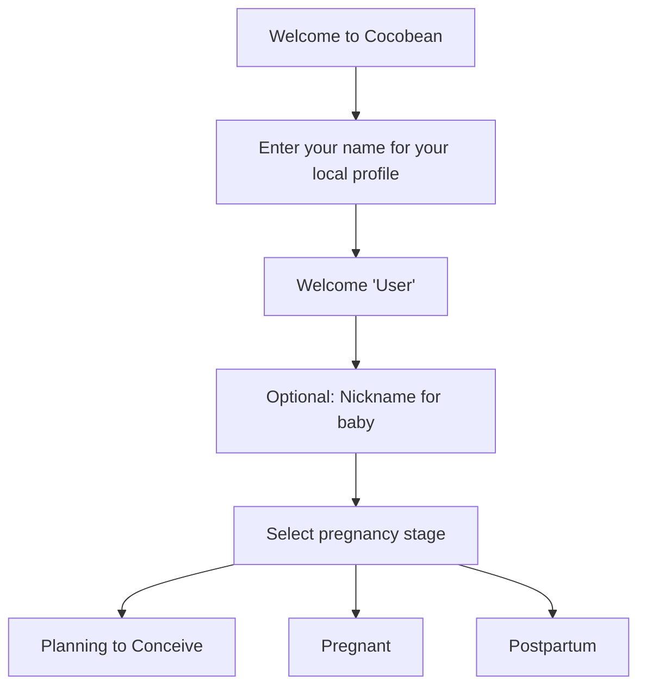
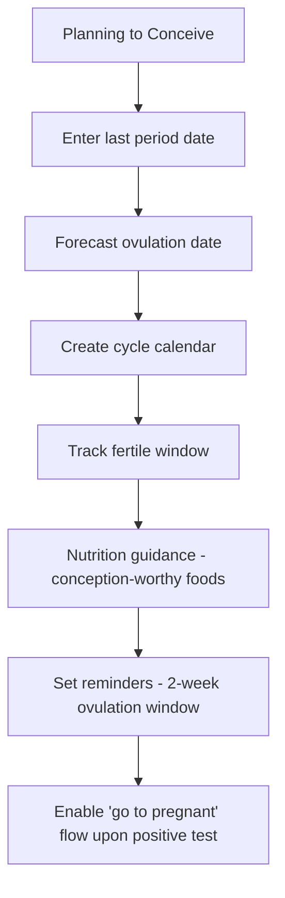
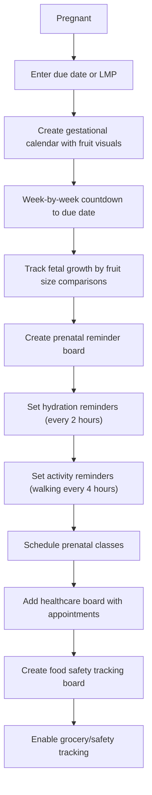
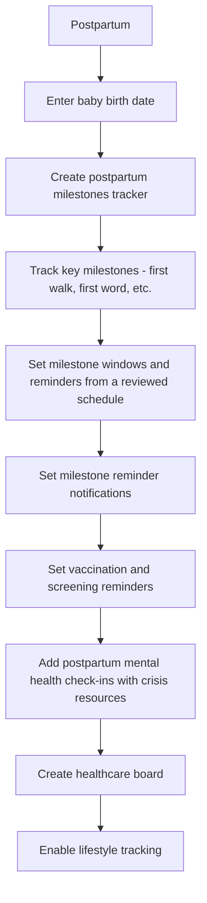
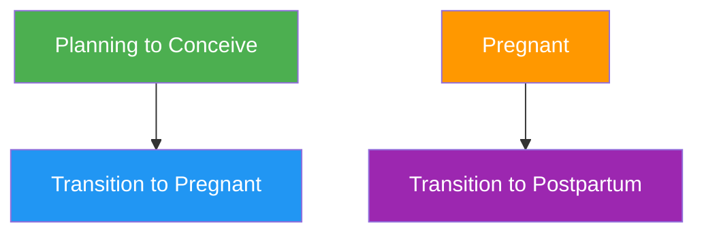

# Cocobean User Journey Flow

> **Scope note:** This describes happy-path journeys. It is subordinate to
> [product-brief.md](product-brief.md), [domain-model.md](domain-model.md), and
> [clinical-rules.md](clinical-rules.md). Unhappy paths and sensitive scenarios are in
> [edge-cases.md](edge-cases.md). See [README.md](README.md) for the document map.
>
> **MVP scope:** the MVP journeys are the Main Entry Point (onboarding) and the Pregnant
> Flow (pregnancy journey), plus the kick counter, appointments, and hospital bag. The
> Planning, Postpartum, and Food Safety flows are post-MVP. See [mvp.md](mvp.md).

This document documents the user journey flow for the Cocobean application, including detailed user flows for each pregnancy stage.

## 📍 Main Entry Point [MVP]

## 👨‍🍼 Planning to Conceive Flow [Post-MVP]

### Overview

### Detailed Flow

1. **Calendar Setup**
   - Track menstrual cycles
   - Forecast ovulation dates
   - Identify fertile windows
   - Provide conception timing guidance

2. **Nutrition Tracking**
   - Reminders for conception-friendly foods (blueberries, avocados, etc.)
   - Educational content about timing nutrition for fertility
   - Integration with food database for tracking

3. **Conception Window Management**
   - Set reminders for the 2-week window between ovulation and next expected period
   - Track tests and nutrition during this critical window
   - Option to transition to "pregnant" flow upon positive pregnancy test

## 🤱 Pregnant Flow [MVP]

### Overview

### Detailed Flow

1. **Calendar & Growth Tracking**
   - Visual due date calendar with countdown
   - Week-by-week progression visualization
   - Fruit-based growth comparisons (e.g., "baby is now size of raspberry")
   - Interactive growth timeline

2. **Prenatal Reminders & Activities**
   - Hydration reminders every 2 hours
   - Walking reminders every 4 hours
   - Prenatal yoga and light exercise schedules
   - Self-care and mental health check-ins

3. **Healthcare Management**
   - Calendar integration for ultrasounds
   - Doctor appointment tracking
   - Immunization schedule reminders
   - Add appointments to the system calendar (one-way insert).

4. **Food Safety & Risk Tracking** [Post-MVP]
   - Input food intake
   - Select pregnancy-specific conditions (gestational diabetes, etc.)
   - Track glucose/sugar/salt intake
   - Safety categorization (Safe/Moderate/Avoid)

5. **Birth Planning**
   - Review common birth plan topics (pain relief, support people, newborn care).
   - Mark each topic as considered and choose the options to follow.
   - Add notes; no recommendation or "correct" answer.

## 👶 Postpartum Flow [Post-MVP]

### Overview

### Detailed Flow

1. **Milestone Tracking**
   - First walk, sleep through the night
   - First word, first smile
   - Developmental milestone calendar
   - Growth trend tracking (percentile curves in V1.1)

2. **Health & Wellness**
   - Vaccination schedule tracking
   - Mom's postpartum screenings
   - Physical recovery reminders
   - Mental health check-ins (EPDS) with crisis resources

3. **Lifestyle & Self-Care**
   - Nutrition for breastfeeding
   - Sleep tracking and recommendations
   - Exercise progression for new moms
   - Self-care and mental wellness

## 🔄 Navigation Between Stages [Post-MVP]

## 📊 User Flow Summary

| Stage | Entry Point | Key Features | Primary Screens |
|-------|-------------|--------------|-----------------|
| Planning to Conceive | Menstrual Cycle Setup | Cycle tracking, ovulation forecast, nutrition guidance | Dashboard, Calendar, Nutrition |
| Pregnant | Due Date Setup | Gestational calendar, fruit growth visuals, prenatal reminders | Growth Tracker, Reminders, Healthcare |
| Postpartum | Birth Date Setup | Milestone tracking, health monitoring, lifestyle guidance | Milestones, Health Board, Lifestyle |

## 🎯 Key User Touch Points

1. **First Time Setup** - Account and pregnancy stage selection
2. **Daily Reminders** - Hydration, activity, supplements, check-ins
3. **Milestone Tracking** - Growth, development, health markers
4. **Food Safety** - Real-time tracking with pregnancy-specific guidance
5. **Healthcare Integration** - Appointment and test scheduling
6. **Stage Transitions** - Smooth flow between pregnancy phases

## 🔄 User Flow Integration Notes

- **Data Continuity**: User data flows seamlessly between stages
- **Reminder Consistency**: All reminders integrate with system notification system
- **Visual Progress**: Fruit-based growth comparisons make development tangible
- **Healthcare Integration**: One-way calendar insert across all stages for comprehensive care
- **Adaptive Guidance**: Content adjusts based on user's current pregnancy stage
